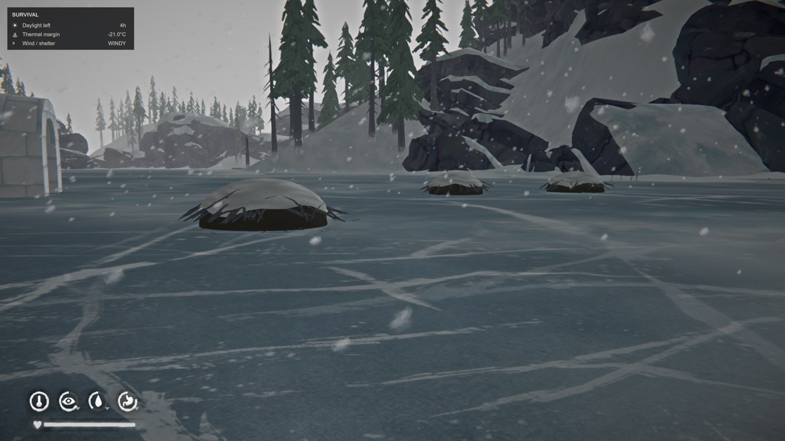
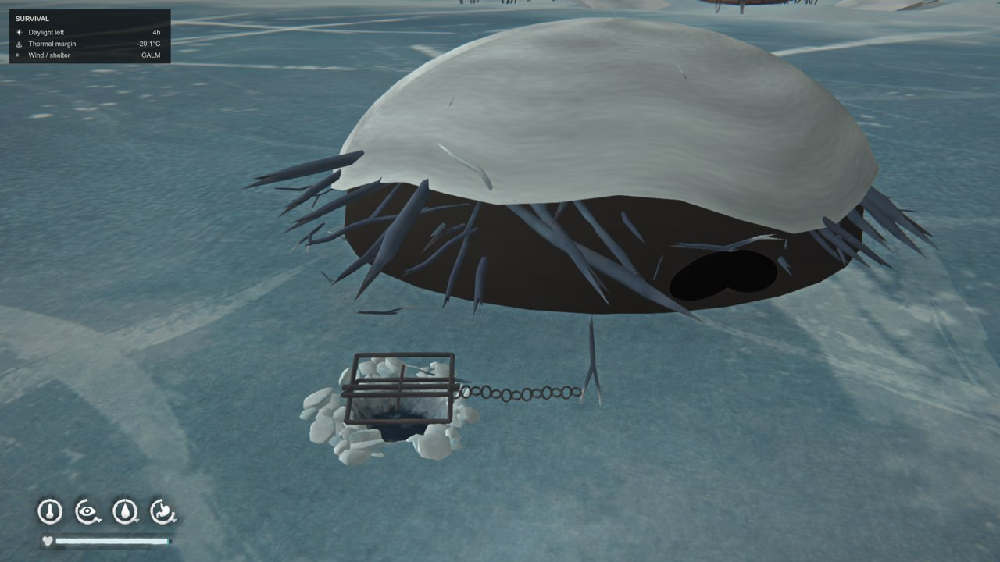

# Burebista Beaver

**v0.5.2 · The Long Dark · Español / English**

[Descargar / Download](https://github.com/florynstefanache-source/BurebistaBeaver/releases/latest) · [English](#english)

Capturas de la partida de Burebista. / Screenshots from Burebista's game.

## Español

Un sistema de captura de castores bajo el hielo, con madrigueras de ramas, barro y nieve, agujeros que se congelan, trampas fabricables y recursos para hacer ropa y otros objetos.

### Madrigueras y partida guardada

Las madrigueras aparecen automáticamente junto a las orillas de los lagos de agua dulce detectados, también en partidas existentes. El objetivo actual es **3 por lago**, separadas al menos 40 metros cuando hay espacio seguro. Los estanques pequeños pueden tener menos. No todas las regiones o lagos del juego se han verificado individualmente.

Al entrar en una región, deja pasar entre 15 segundos y un minuto sin pausar para que termine la búsqueda. Conserva los agujeros, trampas y capturas guardados; no crea trampas gratis. Las madrigueras usadas o manuales se conservan, por lo que puede haber más de tres en un lago utilizado.

### Fabricar y cazar

1. Fabrica una trampa en el banco de trabajo: **martillo, 5 trozos de metal y 1 palo; 2 horas**. También funciona desde el banco del tipi.
2. Acércate a una madriguera y usa **E** para abrir el menú y preparar su agujero. Limpia el hielo antes de instalar la trampa.
3. Ceba con **corteza de abedul o un plantón de abedul fresco o curado**. Si tienes varias opciones, se usa primero la corteza.
4. Espera **6 horas del juego**, también cuentan dormir y pasar tiempo. Cada intento tiene un **50 % de probabilidad**.
5. Si hay captura, limpia el hielo si hace falta y selecciona recoger el castor. Si falla, pulsa **Intentarlo más** para iniciar otras seis horas conservando el cebo.

El agujero se congela progresivamente y se vuelve a abrir limpiándolo, como en la pesca. La captura permanece **debajo del hielo**: no se muestra un animal encima del agujero. Revisar la trampa no adelanta el reloj ni repite el sorteo. Recoge la captura antes de retirar la trampa; al retirarla no se devuelve el cebo.

### Despiezar y curar

Suelta el castor desde la mochila, apunta a él y pulsa **E**. Necesitas un cuchillo o hacha utilizable. El despiece dura **45 minutos** y consume un 1 % de la herramienta al terminar.

Entrega **1 piel fresca, 2 tripas frescas y 2 porciones de grasa de 250 g**. El cuerpo desaparece después de completar la entrega. Cancelar conserva el castor. La grasa es material de fabricación, no comida; esta versión no entrega carne.

La piel se cura durante **5 días** en un interior válido o bastidor compatible, incluidos los bastidores de tus mods del tipi y del iglú. Las tripas siguen el curado normal del juego. La grasa no necesita curado.

### Recetas con piel y grasa

| Resultado | Materiales | Lugar y tiempo |
| --- | --- | --- |
| 2 retales de cuero | 1 piel curada | Banco, cuchillo, 45 min |
| 2 porciones de sebo | 1 grasa | Fuego encendido, 20 min |
| 1 vela | 2 grasas + 1 mecha | Fuego encendido, 60 min |
| Gorro de castor | 2 pieles curadas + 2 tripas curadas | Banco, costurero, 4 h |
| Manoplas de castor | 2 pieles curadas + 2 tripas curadas | Banco, costurero, 3 h |

**Vela y sebo requieren Candlelight y su paquete `candlelight.modcomponent`.** Las otras recetas no necesitan Candlelight. La ropa se fabrica desde el menú normal, también en los bancos del tipi y del iglú; no hay una pestaña exclusiva del castor.

| Prenda al 100 % | Calor | Viento | Resistencia al agua | Peso |
| --- | --- | --- | --- | --- |
| Gorro | +3,5 °C | +3 °C | 75 % | 0,45 kg |
| Manoplas | +3 °C | +3 °C | 75 % | 0,50 kg |

Son prendas equipables, visibles en la pantalla de ropa, con acabado marrón sobre las formas nativas de TLD. Para repararlas: **1 piel curada de castor + 1 tripa curada**, con costurero o aparejo de pesca; 60 minutos base. Recuperación base: 35 puntos para el gorro y 30 para las manoplas. La condición y humedad afectan a los bonus como en el juego normal.

### Colocar la trampa como decoración

Suéltala desde la mochila y muévela con el control normal de objetos para colocarla en suelo, mesa o pared. Para **cazar**, recógela y **instálala desde el menú E de un agujero de castor abierto**. La colocación decorativa no activa una captura.

### Instalación

1. Instala **MelonLoader y ModData**. Cierra el juego.
2. Descarga `BurebistaBeaver-v0.5.2-ES-EN.zip` desde Releases.
3. Copia `Mods/BurebistaBeaver.dll` a la carpeta `Mods` de The Long Dark.
4. Reemplaza la versión anterior; guarda las copias antiguas fuera de `Mods` y deja una sola DLL del mod.
5. Abre el juego. Los textos, recetas y menús siguen su idioma: español o inglés.

Los modelos y texturas propios están integrados en la DLL. No requiere el antiguo `BurebistaLanguages.dll`. Descarga el ZIP de la release, no el archivo automático del repositorio.

## English

A beaver trapping system under the ice, featuring snowy branch-and-mud lodges, freezing ice holes, craftable traps, pelts, fat and wearable clothing.

### Lodges and existing saves

Lodges spawn automatically near the shores of detected freshwater lakes, including existing saves. The current target is **3 per lake**, at least 40 metres apart where safe space permits. Small ponds may have fewer. Not every lake or region has been individually verified. Allow 15–60 seconds of unpaused play after entering a region. Used and manually placed lodges are preserved, so established lakes may have more. Saved holes, traps and catches remain; traps are not provided for free.

### Crafting and trapping

1. Craft a trap at a workbench, including the tipi bench: **hammer, 5 scrap metal and 1 stick; 2 hours**.
2. Approach a lodge and press **E** to prepare its ice hole. Clear the ice before installing the trap.
3. Bait with **birch bark, a fresh birch sapling or a cured birch sapling**. Bark is used first if several options are available.
4. Wait **6 in-game hours**; sleeping and passing time count. Each attempt has a **50% chance**.
5. Collect a successful catch after clearing any ice. If unsuccessful, select **Try again** to begin another six-hour attempt with the same bait.

Ice gradually refreezes and can be cleared again, like a fishing hole. The catch stays **under the ice** until collected. Checking does not advance the clock or reroll the outcome. Collect catches before removing a trap; removing it does not return the bait.

### Harvesting and curing

Drop the captured beaver, aim at it and press **E**. Requires a usable knife or hatchet; takes **45 minutes**, with 1% tool wear on completion. Yields **1 fresh pelt, 2 fresh guts and 2 portions of fat, 250 g each**. The body disappears after successful resource delivery; cancelling preserves it. Fat is a crafting material, not food. This version does not yield meat.

Pelts cure in **5 days** in a valid interior or compatible drying rack, including the tipi and igloo racks. Guts use normal TLD curing; fat does not need curing.

### Resource recipes and clothing

| Result | Ingredients | Location and time |
| --- | --- | --- |
| 2 cured leather | 1 cured pelt | Workbench, knife, 45 min |
| 2 tallow portions | 1 fat | Lit fire, 20 min |
| 1 candle | 2 fat + 1 wick | Lit fire, 60 min |
| Beaver hat | 2 cured pelts + 2 cured guts | Workbench, sewing kit, 4 h |
| Beaver mittens | 2 cured pelts + 2 cured guts | Workbench, sewing kit, 3 h |

**Tallow and candle recipes require Candlelight and `candlelight.modcomponent`.** Other recipes do not. Clothing recipes appear in normal crafting, including tipi and igloo workbenches; there is no separate beaver category.

At full condition, the hat provides **+3.5 °C warmth, +3 °C wind protection, 75% water resistance**, weighing **0.45 kg**. Mittens provide **+3 °C warmth, +3 °C wind protection, 75% water resistance**, weighing **0.50 kg**. These wearable items use native TLD clothing shapes with a brown finish and clothing-screen artwork.

Repair either with **1 cured beaver pelt + 1 cured gut**, using a sewing kit or fishing tackle; base time 60 minutes. Base condition recovery is 35 points for the hat and 30 for mittens. Normal condition and wetness rules affect bonuses.

### Decorative trap placement

Drop the trap and use normal object movement to place it on a floor, table or wall. To **catch beavers**, retrieve it and **install it through the E menu at an open beaver ice hole**. Decorative placement does not activate trapping.

### Installation

1. Install **MelonLoader and ModData**, then close the game.
2. Download `BurebistaBeaver-v0.5.2-ES-EN.zip` from Releases.
3. Copy `Mods/BurebistaBeaver.dll` into The Long Dark's `Mods` folder.
4. Replace the previous version; keep backups outside `Mods` and only one copy of this DLL inside it.
5. Launch the game. Text, recipes and menus follow its language: Spanish or English.

Custom models and textures are embedded in the DLL. The old `BurebistaLanguages.dll` is not required. Use the release ZIP rather than GitHub's automatic repository archive.

## Versión / Version 0.5.2

Traducción español/inglés; conserva capturas, recursos y guardados. Compilación y 319 comprobaciones de reglas, guardado, idioma e identidad superadas. Funcionamiento confirmado por Burebista en su partida. No incluye castores vivos paseando por el mapa.

Spanish/English localization preserving catches, resources and saved data. Build and 319 rules, save, language and identity checks passed. Burebista confirmed it working in their game. Does not include live beavers roaming the map.

## Créditos / Credits

Mod y capturas: Burebista. The Long Dark pertenece a Hinterland Studio. Mod de aficionados no oficial. Los recursos nativos se cargan desde el juego. / Mod and screenshots: Burebista. The Long Dark belongs to Hinterland Studio. Unofficial fan mod; native assets are loaded from the game.